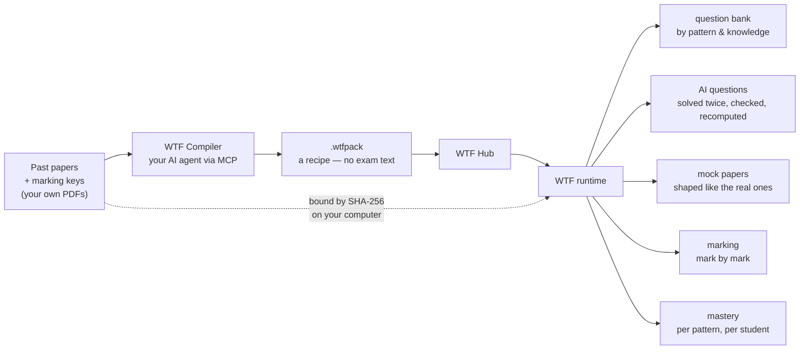

# WTF — Worldwide Teachers Friend

> **Every past paper, reverse-engineered. Every mark, accounted for.**

Hand WTF a course's past papers and their marking keys. It hands you back the course: every question split by what it
tests, every mark by what earns it, notes for every question type, statistics on what the examiners really ask, papers
that look like the real thing, and a mastery map that knows which mark you keep losing.

Then it does it again for the next course. And the next exam board.

*Yes, the acronym is intentional. No, we will not be taking questions about it. The app will generate them for you.*



---

## ⬇ Download

| | |
|---|---|
| **Windows** | [**WTF-Setup.exe**](https://github.com/LxCenady/worldwide-teachers-friend/releases/latest/download/WTF-Setup.exe) — double-click it. That is the whole installation. |
| **Mac, Apple silicon** | [**WTF-macOS-arm64.dmg**](https://github.com/LxCenady/worldwide-teachers-friend/releases/latest/download/WTF-macOS-arm64.dmg) |
| **Mac, Intel** | [**WTF-macOS-x86_64.dmg**](https://github.com/LxCenady/worldwide-teachers-friend/releases/latest/download/WTF-macOS-x86_64.dmg) |

WTF ships **no subject**. On first run it opens **WTF Hub**: pick the courses you take, and WTF downloads each pack,
checks it against the Hub's SHA-256, and asks for the course's original papers. You bring the papers; WTF does the rest.

---

## What "reverse-engineering an exam" means here

Most revision apps store questions. WTF stores **the marking**.

Every part of every past question becomes a **scoring tree**: the exact awards the official key gives, how they combine
(sum, best-of alternatives, "any 2 of 4", capped bands), which ones depend on others (an A mark needs its M mark),
which ones may follow through from an earlier error. Every award carries the **question pattern** it rewards and the
**knowledge** it needs. Nothing is invented to make totals match: when a key is genuinely holistic or broken, the tree
says so and the original crop is shown.

From that one model, everything else is computed rather than guessed:

| You get | Because WTF knows |
|---|---|
| **The question types of a course**, each with original bilingual method notes and every past question that uses it | which award rewards which pattern |
| **"What do they actually ask?"** — marks per pattern, per section, per year; which patterns travel together | every award's marks, per paper |
| **AI practice questions** that look like the exam: written, independently solved, cross-checked, split into one mark point per mark, and recomputed by SymPy (to the dollar, in Accounting) | the pattern's notes, the course's own question-writing skill, and real examples |
| **Mock papers** built from the shapes of real questions, not from a random number generator | how many marks each pattern carried in each real question |
| **Marking** — self-marking for students, mark-by-mark for teachers — and a **mastery map** that tells you where the next hour goes | which awards were lost, and what they test |

---

## The receipts

We like big claims. We like them more with numbers you can check. Every number below comes from an acceptance run in
this repository.

| | |
|---|---|
| **Subject packs** | **7**: Mathematics Methods, Specialist and Applications, Chemistry, Physics, Accounting and Finance (WACE ATAR), and Cambridge International AS & A Level Mathematics 9709 |
| **Exam boards** | 2: SCSA (Western Australia) and Cambridge International |
| **Past questions** | **1,343** — 1,243 WACE (2016–2025) + 100 Cambridge (June 2024 and 2020 specimen) |
| **Scoring trees** | **3,665 parts**, every one with its maximum equal to the printed marks |
| **Cambridge 9709, from zero** | 12 papers → 100 questions → 221 parts → **849 awards** → 72 patterns, 44 knowledge atoms. Compiled through MCP by **two different AI agents taking turns** (one ran out of quota mid-parse; the other picked up the project and finished it). A human decided exactly six things: what to do about six defects in the official mark schemes themselves |
| **Accounting and Finance** | 1,111 award records labelled bottom-up, assigned to an approved catalogue, then **blind-reviewed**: 92.5% pattern agreement on a 308-award sample; all 23 disputes arbitrated in writing |
| **Every data pack** | exported, installed into an empty folder, rebuilt from the original PDFs, and compared table by table with the reference: **0 differing rows** |
| **Exam text redistributed** | **0 bytes**. Packs are recipes; the papers stay yours |
| **Installer** | 64 MB, no subject inside. Every course is a download away |

---

## Three ways in

### 🎓 Students — WTF

Install, open WTF Hub, choose your courses, give WTF the papers (it downloads the archived ones itself and tells you
exactly which to save from the official site). Then: browse by question type, do a past question, reveal the key, tick
the marks you lost. WTF writes you new questions on exactly those steps, brings your mistakes back after 1, 3, 7, 14 and
30 days, and sits you a timed mock when you are brave. Free and open source. Bring your own model key, or sign in to a
WTF Academy account.

### 🧑‍🏫 Teachers — WTF Studio

The teacher edition: class lists, students' scripts mapped to the roster, **marking mark by mark** (with AI proposals
you confirm or overrule), mastery per student and per class, one-click papers built to a real paper's blueprint, and
assignments with grade sheets. Studio is a subscription product of [WTF Academy](https://wtf-academy.org); it runs on
the same open-source core and the same packs.

### 🛠 Anyone with past papers — WTF Compiler

Your school's exam, your country's board, the course nobody has bothered with. Open **WTF Compiler** (free, inside
WTF), point it at the exam PDFs, the marking keys and the syllabus, and connect **your own AI agent** over MCP. The
Compiler hands the agent one stage at a time — pair, parse into scoring trees, classify every award, write notes and
a question skill, review against the original pages — and checks every stage's JSON before accepting it. Anything the
agent is unsure of stops at a review gate for a human. Out comes a `.wtfpack` anyone can install.

*Your agent does the thinking. The Compiler checks whether the thinking arrived in valid JSON.*

[Workflow and protocol](docs/compiler.md)

---

## WTF Hub

The Hub is an index of packs ([hub/index.json](hub/index.json)): name, version, minimum WTF version, download, size,
SHA-256 and quality tier. The app lists it, downloads what you choose, and refuses anything whose hash does not match.

| Pack | Course | Tier |
|---|---|---|
| `MAM` | Mathematics Methods ATAR · 174 questions · 51 patterns | official |
| `MAS` | Mathematics Specialist ATAR · 193 questions · 45 patterns | official |
| `MAA` | Mathematics Applications ATAR · 138 questions · 67 patterns | official |
| `CHE` | Chemistry ATAR · 400 questions · 64 patterns | official |
| `PHY` | Physics ATAR · 203 questions · 79 syllabus nodes × 11 award skills | official |
| `ACF` | Accounting and Finance ATAR · 135 questions · 114 patterns · 283 knowledge atoms | official |
| `CAIE9709` | Cambridge International AS & A Level Mathematics (9709) · 100 questions · 72 patterns | experimental |

**Publishing a pack:** add the file to [`packs/`](packs), run `python tools/hub_index.py packs --base <download folder>`,
and open a pull request. Experimental packs are welcome; they are labelled as such.

---

## How a pack is made (the pipeline with gates)

| Stage | What happens | Gate |
|---|---|---|
| **Pair** | each exam with its own key, recognised from their contents | same questions, same marks |
| **Parse** | every question, part and award; crops bound to the original pages | every part's tree maximum = its printed marks; every paper's total = its cover |
| **Label** | every award described bottom-up: what is rewarded, what it needs | every award labelled |
| **Atomise** | labels clustered into question patterns and knowledge atoms | **a human approves the catalogue** |
| **Assign** | every award gets its pattern and 1–3 knowledge atoms | every award placed |
| **Blind review** | a second agent, who never saw the first answer, assigns a sample again | **≥ 90% agreement**, every dispute arbitrated |
| **Notes & skill** | original bilingual method notes, a cheat sheet, a question-writing skill | every cited question carries that pattern |
| **Export & prove** | `.wtfpack`, reinstalled into an empty folder and rebuilt from the originals | **0 differing rows** |

Official mark schemes have mistakes too. When the key contradicts itself, WTF keeps the original and an independent
recomputation side by side and marks the affected award **teacher-only**. No model gets to quietly decide which version
of the examiners was right.

---

## Architecture, in one breath

WTF is the **runtime of its packs**. The runtime holds the business logic — the bank, generation, verification,
marking, statistics, the interface. The pack holds the course — names, sections and timing, how its papers are
recognised, its patterns and knowledge, every award's code, its notes and skill, where its papers come from.
**Packs are data and cannot carry code.** A new course is a new pack, not a fork. There is no secret subject hidden in
`main.py`, waiting for its own `if` statement.

```text
microkernel (services + events) ── plugins, one job each ── one question bank for every pack
```

---

## Copyright — not a joke

Past papers, marking keys and examiners' reports belong to their exam boards (© SCSA, © Cambridge University Press &
Assessment). **They are not in this repository and not in any pack.** A pack records *where* to obtain each paper and
its SHA-256; you obtain the papers yourself, legally, and WTF builds everything on your computer. Notes, catalogues,
skills and code here are original work.

---

## Known limits (stated plainly, as is tradition)

- The Cambridge pack is **experimental**: compiled by agents, structurally verified, not reviewed by a person. Its
  notes are shorter in Chinese than in English.
- The recipe protocol has no exam-session field yet; Compiler packs read the year from each paper's cover.
- Scoring trees are the one scoring model; per-student mastery across WTF and Studio is being unified onto them.
- The Mac builds are tested by CI, not yet on a real Mac by us.
- No part of this software will sit the exam for you. We looked into it.

---

## 中文

**WTF — Worldwide Teachers Friend：把每一份真题逆向工程，把每一分算清楚。**

给 WTF 一门课的历年真题和评分标准，它还你整门课：每道题按考点拆开，每一分按得分行为拆开，每个题型配原创双语讲义，统计考官真正爱考什么，出和真卷一样的题、组和真卷一样的卷，再用掌握度地图告诉你下一小时该花在哪里。然后换一门课、换一个考试局，再来一遍。

- **学生**：装 WTF，在 WTF Hub 选课，按提示提供原卷，开刷。免费开源。
- **老师**：WTF Studio（WTF Academy 订阅版），逐分批改、AI 批卷建议由老师确认、班级与学生掌握度、按真卷蓝图一键组卷、作业与成绩表。
- **任何手里有真题的人**：用 WTF 里免费的 WTF Compiler，通过 MCP 接入你自己的 AI 代理，把任何课程做成 `.wtfpack`，提交到 WTF Hub。

**硬数字**：7 个学科包、2 个考试局、1,343 道真题、3,665 个小问的评分树（满分全部等于卷面分值）；Cambridge 9709 由两个 AI 代理通过 MCP 接力从零做成，人只裁决了官方评分标准自身的 6 处错误；会计包盲审题型一致率 92.5%；每个数据包都经过「导出 → 空目录重装 → 用原卷重建 → 逐表 0 差异」。

**版权**：试卷、评分标准和考试报告属于各考试局，不在本仓库、也不在任何学科包里。包只是「配方」，原卷由你合法获取，WTF 在你的电脑上建库。

---

## Licence

Code: MIT (`LICENSE`). Notes, catalogues, cheat sheets and skills: CC BY-NC-SA 4.0. Exam material: © its exam boards,
not included.
